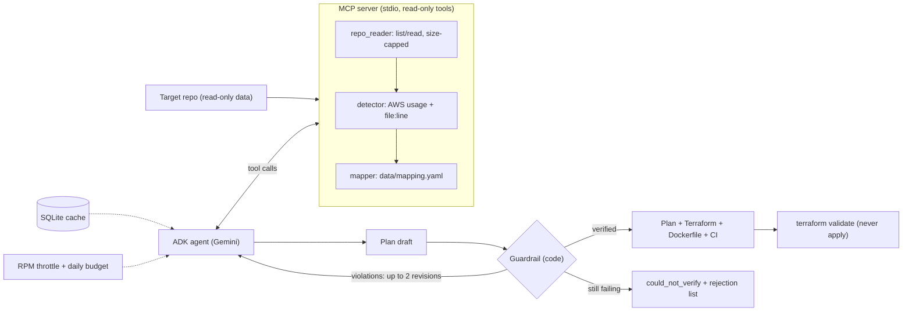

# MigrateLens

[](https://github.com/abhibarnwal707/MigrateLens/actions/workflows/ci.yml)

An AWS → Google Cloud migration copilot built on Google's **Agent Development Kit (ADK)** and **Gemini**.
Point it at a small application repository that runs on AWS and it will:

1. **inventory** the AWS services it uses, with `file:line` evidence,
2. **map** each one to a Google Cloud equivalent from a curated table, with trade-offs and risks,
3. write a **migration plan** (risks, rollout and rollback, least-privilege IAM notes),
4. generate **Terraform, a Dockerfile and a CI pipeline file**,
5. **refuse to state anything it cannot back with evidence** from the repo (a guardrail enforced in code),
6. and be **scored by an evaluation harness** against hand-written ground truth, next to a no-agent baseline.

**Website:** _add the GitHub Pages URL here after the first deploy (see [Publish the website](#publish-the-website-free))._
An animated circuit-board view of the real evaluation runs, built from `site/` with no build step.

**Live analysis demo:** _add the Streamlit Community Cloud URL here after deploying (see [Deploy the demo](#deploy-the-demo-free))._

> **Generated Terraform is validated, not deployed.** The Terraform targets Cloud Run and friends and is
> checked with `terraform init -backend=false && terraform validate` only. Nothing in this project creates,
> or needs, a Google Cloud resource, billing account or credit card.

## Architecture



The guardrail checks, in code and not just in the prompt, that every AWS service named in a plan is in the
detector inventory, every Google Cloud product is in `mapping.yaml`, every cited file and line exists, and
that no dollar amounts appear. See [`docs/ARCHITECTURE.md`](docs/ARCHITECTURE.md).

## Results

<!-- RESULTS:START -->

7 apps (6 public AWS sample repos + 1 synthetic), ground truth human-reviewed. Free-tier Gemini. Reproduce with zero API calls: `make eval && make baseline && make report`.

| Metric | MigrateLens agent | No-tools baseline |
|---|---|---|
| Invented-resource rate, first draft (lower is better) | 0.2% | 12.0% |
| Plans that passed the guardrail (of 7) | 6/7 | n/a (no guardrail) |
| Mapping accuracy, all apps (failed run scores 0) | 85.7% | 94.8% |
| Mapping accuracy, verified plans only (6 apps) | 100.0% | n/a |
| Service recall, all apps | 85.7% | 98.4% |
| Risk coverage (keyword rubric) | 76.4% | 81.0% |
| `terraform validate` pass rate | 6/6 | n/a |
| Mean model calls per app | 7.9 | 1.0 |

**Honest reading:** the agent's clear win is the invented-resource rate. It did not beat the baseline on service recall, risk coverage or all-apps mapping accuracy: `sns-email-china` could not be verified by the guardrail, which only accepts services in the detector inventory. With n=7 the intervals are wide; see [`docs/RESULTS_SUMMARY.md`](docs/RESULTS_SUMMARY.md) for intervals and per-app rows.

<!-- RESULTS:END -->

## Run it for free

Requires Python 3.12, [`uv`](https://docs.astral.sh/uv/), and (optionally) Terraform and Docker.
No paid service is used anywhere.

```bash
git clone https://github.com/abhibarnwal707/MigrateLens && cd MigrateLens
uv sync
echo 'GEMINI_API_KEY=your-key' > .env     # free key: https://aistudio.google.com/apikey (no card)

make test          # unit tests, no API calls
make lint
make eval          # replay the recorded agent runs: zero API calls
make baseline      # replay the recorded baseline runs: zero API calls
make report        # regenerate docs/RESULTS_SUMMARY.md, docs/RESUME_NUMBERS.md and the table above
make demo          # Streamlit demo on localhost

# analyse any repo yourself (uses the free tier; capped by a daily budget)
uv run python -m migratelens.pipeline path/to/repo out_dir
```

Free-tier details and the rate-limit protections are in [`docs/FREE_TIER.md`](docs/FREE_TIER.md).
The sample apps, licences and pinned commits are in [`eval/apps/README.md`](eval/apps/README.md).

## Deploy the demo (free)

1. Push the repo to GitHub (public).
2. On [share.streamlit.io](https://share.streamlit.io) choose **New app**, pick the repo, and set the main file
   to `app/streamlit_app.py`. Under **Advanced settings** pick **Python 3.12**.
3. Under **Advanced settings → Secrets** add `GEMINI_API_KEY = "your-key"`.
4. Open the URL in a private window to confirm it works logged out.

Bundled samples replay recorded runs and use no quota. Live analysis of a pasted public GitHub URL is capped
(2 runs per visitor session, 15 per day for the whole app). The hosted app has no Terraform binary, so live
runs show `terraform validate: not run`.

## Publish the website (free)

`site/` is a static page (HTML, CSS, JS, no build step) whose every number comes from `site/data.json`,
generated from the eval results by `make site` (a test fails if it is stale). Preview it with `make site-serve`.

1. In the GitHub repo: **Settings → Pages → Build and deployment → Source: GitHub Actions**.
2. Push to `main`. The `site` workflow (`.github/workflows/pages.yml`) publishes `site/` to
   `https://<user>.github.io/MigrateLens/`. Public repos use GitHub Pages and Actions for free.

Pictures and the 1947 newsreel are from open collections; their credits are in the site footer.

## Honest limitations

- **Small sample.** 7 apps (6 real, 1 synthetic Java). Confidence intervals are wide and most gaps could be noise.
- **Not independent for the detector.** SAM and CDK support was added after a first run on these apps showed
  every miss came from those formats. Both runs are kept under `eval/results/`.
- **The guardrail rejects what it cannot verify.** A repo that genuinely uses services outside `mapping.yaml`
  and the detector (for example EC2) cannot get a verified plan. That happened on one eval app.
- **The retry loop was not exercised by a real failure on the apps that passed:** every verified plan was clean
  on the first draft. Its recovery behaviour is covered by a unit test, not by these runs.
- **The guardrail only recognises AWS and Google Cloud names from fixed vocabularies.** A made-up product
  name outside both lists would not be caught.
- **Risk coverage is a keyword rubric**, not an LLM judge, so it can miss paraphrases.
- **Free-tier Gemini, one model.** Free-tier prompts may be used by Google, so only public repos are analysed.
- **AWS → Google Cloud only.** Terraform is validated, never applied; nothing was deployed to Google Cloud.
- **Terraform pass rate measures the templated generator**, not the language model.

## Reuse the platform parts

The cache, throttle, tool layer, guardrail pattern and evaluation harness are generic; the migration logic
lives in `migratelens/tools/` and `migratelens/data/mapping.yaml`. See [`docs/ARCHITECTURE.md`](docs/ARCHITECTURE.md)
for what is reusable as-is and what is still migration-specific.

## Layout

```
migratelens/   agent.py, pipeline.py, guardrail.py, cache.py, throttle.py, mcp_server.py, tools/, data/mapping.yaml
eval/          apps/ (pinned samples), truth/ (reviewed ground truth), metrics, baseline, run_eval, report, cache.sqlite
app/           streamlit_app.py (live analysis of a public repo)
site/          the website: index.html, style.css, main.js, data.json (generated), img/, media/
docs/          ARCHITECTURE.md, FREE_TIER.md, RESULTS_SUMMARY.md, RESUME_NUMBERS.md
tests/         unit tests (no API calls) and headless Streamlit tests
```
